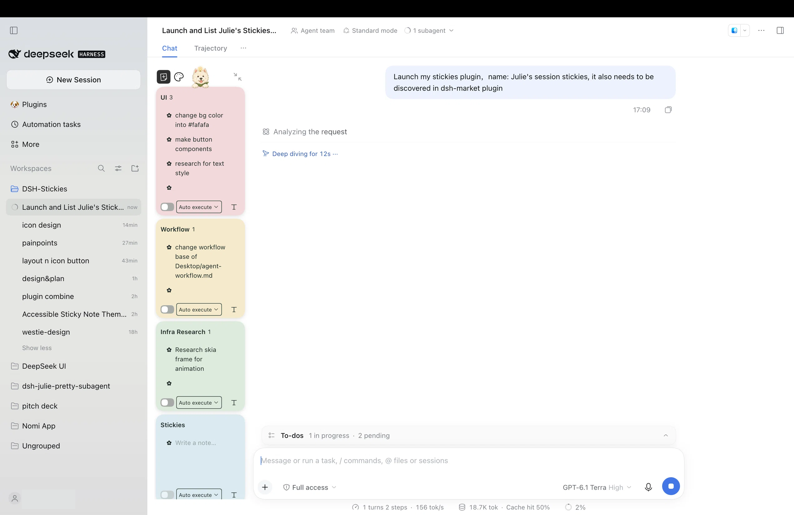

# Julie's session stickies

Colorful, session-specific sticky cards beside your DeepSeek Harness conversation. Capture notes without interrupting your chat, then optionally authorize selected notes as sequential agent follow-ups.



## Features

- Multiple named, resizable cards per session, with editable checklists, bullets, numbering, text and colors.
- Notes persist per session; browser-local drafts and card sizes stay on the current browser.
- Collapse the board when you need more space. Use ⌘⌥⇧N on macOS or Ctrl+Alt+Shift+N on Windows while the expanded board is focused in the current view.
- Auto run is opt-in: choose notes and **Answer only** or **Execute**, then explicitly run the queue. Ordinary notes and agent tools cannot authorize it.

## Installation

This plugin targets the DeepSeek Harness desktop/web profile with protocol version `0.2.2-rc.1`. Install the GitHub bundle from Plugin Manager using `github:juliiiiiiiu/julies-session-stickies`. A page refresh may be needed after activation. GitHub installs can require build permission according to your package manager's policy; inspect the source before allowing it.

The plugin displays beside conversations. Its dog button collapses or expands the board. Enter commits a new note, and Shift+Enter inserts a line break. The card title can be edited directly.

## Safety and storage

Cards and committed notes are stored by the DSH host per session. Drafts, local recovery journals and card sizes are stored in browser-local storage. Clearing browser data may remove those browser-local values. Back up important information before removing storage or changing profiles.

Auto run uses a queue shared across the session. Execute mode uses the current session's permissions; Answer only uses a read-only tool allowlist. Pausing prevents subsequent queue items but does not stop an item already running. Review selected notes and permissions before authorizing them. On restart the plugin pauses uncertain work rather than replaying it automatically.

## Development

Requires Node.js and the host services provided by a compatible DeepSeek Harness installation. The generated client is committed, so consumers do not need to build it.

```sh
node build.mjs
node --check host.js && node --check client.js
node --test test-*.mjs
```

The automated tests cover storage, queue safety, rich-text behavior, sizing, contrast and layout policies. They do not replace interactive testing across browsers and window sizes. See [third-party icon notices](THIRD_PARTY_ICONS.md).
