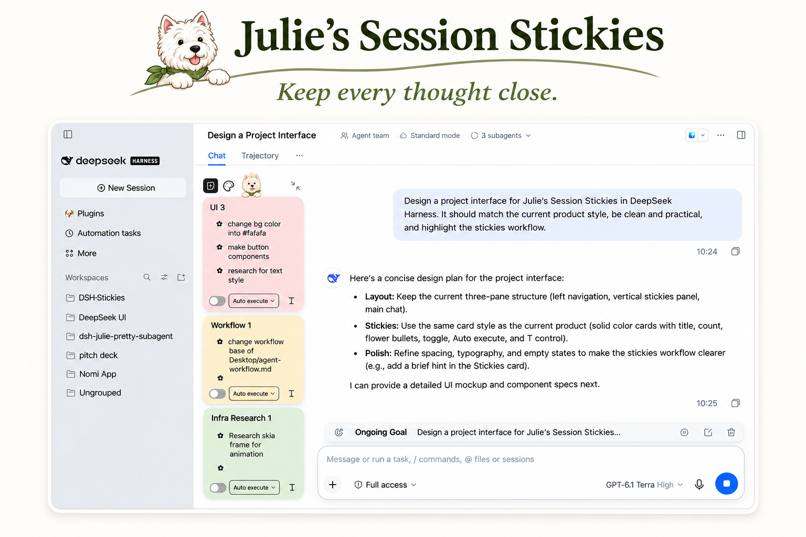
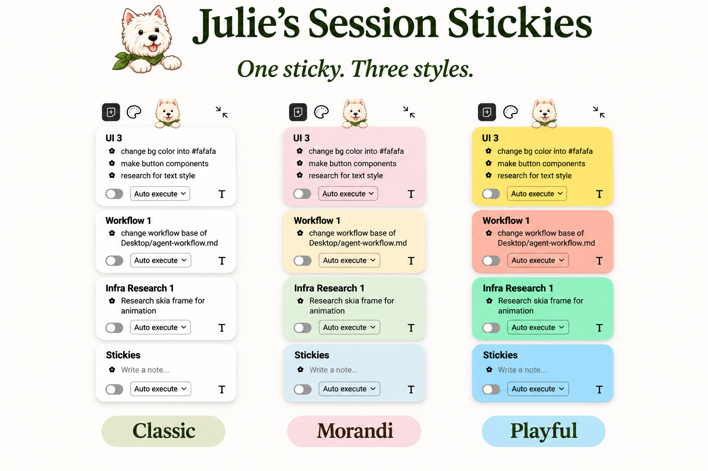

# Session Stickies - Manage Your Attention

**Stay on track while you work on multiple agent tasks**

A plugin that keeps ideas, questions, and follow-ups next to the session they belong to—so you can switch tasks without losing your train of thought.



## The problem

Agents can work in parallel. Human attention can’t.

While an agent is working, you might think of a small change, a question, or something to check. You don’t want to interrupt the task or open a new worktree for every idea. But after switching to another session, it’s easy to forget what you had in mind.

## How it helps

- **Jot down ideas** as they come, without interrupting the agent.
- **Keep questions, tasks, and checkpoints separate**, so each gets the right attention.
- **Turn notes into action** by asking the agent to execute a task or answer a question.
- **Keep work moving** by letting the agent process selected notes in order after the current task finishes.

Session Stickies helps you capture a thought, return to it in context, and turn it into the agent’s next action.

## Three styles



## Compatibility

Currently available for **DeepSeek Harness (DSH)**. Support for other agent harnesses is planned.

**Topics:** `deepseek-harness` `ai-agents` `agent-tools` `session-stickies` `attention-management` `focus` `context-switching` `productivity` `adhd-friendly`

## Installation

This plugin targets the DeepSeek Harness desktop/web profile with protocol version `0.2.2-rc.1`. Install the GitHub bundle from Plugin Manager using `github:juliiiiiiiu/session-stickies-manage-your-attention`, or the public npm package `session-stickies-manage-your-attention`. A page refresh may be needed after activation. GitHub installs can require build permission according to your package manager's policy; inspect the source before allowing it.

The plugin displays beside conversations. Its dog button collapses or expands the board. Enter commits a new note, and Shift+Enter inserts a line break. The card title can be edited directly.

## Safety and storage

Cards and committed notes are stored by the DSH host per session. Drafts, local recovery journals and card sizes are stored in browser-local storage. Clearing browser data may remove those browser-local values. Back up important information before removing storage or changing profiles.

Auto run uses a queue shared across the session. Turning it on authorizes current notes and new notes you commit on that sticky until you turn it off. You can reorder waiting notes; work already started cannot be reordered. The queue runs the text captured when each note was added, so later edits do not alter the queued task. Auto Act can change files using the current session's permissions; Answer only uses a read-only tool allowlist. Turning it off prevents pending work but does not stop an item already running. On restart, the plugin pauses rather than replaying uncertain work. Each authorization supports up to 100 items, including completed items; turn it off and on to start a fresh queue. The first-time explanation is remembered in browser-local storage.

## Development

Requires Node.js and the host services provided by a compatible DeepSeek Harness installation. The generated client is committed, so consumers do not need to build it.

```sh
node build.mjs
node --check host.js && node --check client.js
node --test test-*.mjs
```

The automated tests cover storage, queue safety, rich-text behavior, sizing, contrast and layout policies. They do not replace interactive testing across browsers and window sizes. See [third-party icon notices](THIRD_PARTY_ICONS.md).

## License

This project is released under the [MIT License](LICENSE). List-format icons keep the notices in [THIRD_PARTY_ICONS.md](THIRD_PARTY_ICONS.md).
